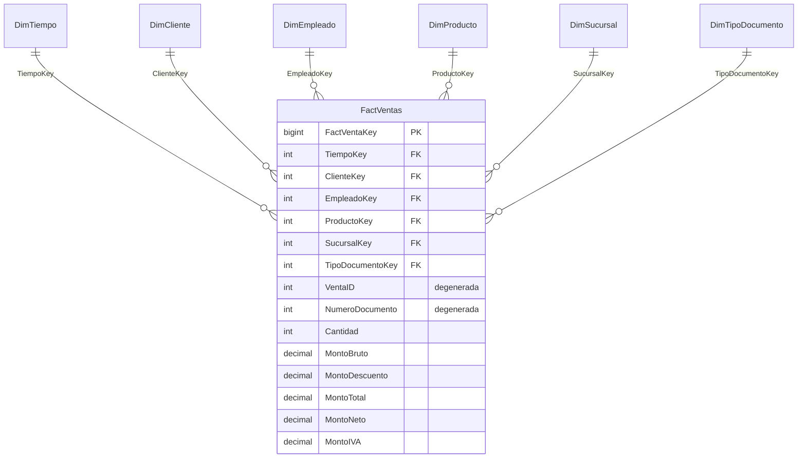

# Mueblería Albarrán – Solución de Inteligencia de Negocios

**Caso Semestral · Inteligencia de Negocios · Fase 1: Modelo Dimensional y Proceso ETL**

| | |
|---|---|
| Integrantes | Ivan Papic · Alberto Aguilera |
| Asignatura / Sección | Inteligencia de Negocios · Paralelo 300 |
| Profesor(a) | Hernan Saavedra González |
| Herramientas | SQL Server 2017+ · SSMS · Visual Studio 2022/2026 + extensión SQL Server Integration Services Projects |

> En la Fase 1 no se incluyen el cubo OLAP (SSAS) ni el dashboard de Power BI; ambos corresponden a fases posteriores.

---

## Contenido del repositorio

```
├── README.md                              ← esta documentación (Fase 1)
├── sql/
│   ├── 00_restaurar_bd_transaccional.sql  ← restaura Albarran.bak (OLTP)
│   ├── 01_crear_modelo_dimensional.sql    ← crea Albarran_DW: dimensiones, hechos, claves, FKs, SPs de soporte
│   ├── 02_etl_equivalente_tsql.sql        ← misma lógica del ETL en T-SQL (verificación cruzada / contingencia)
│   ├── 03_validacion_etl.sql              ← conciliación origen vs destino con valores esperados
│   ├── 04_backup_modelo_dimensional.sql   ← genera Albarran_DW.bak
│   └── 05_consultas_kpi.sql               ← consultas de los KPI sobre el modelo
├── etl/
│   ├── ETL_Albarran.sln                   ← solución de Visual Studio
│   └── ETL_Albarran/
│       ├── ETL_Albarran.dtproj            ← proyecto SSIS
│       ├── ETL_Albarran.dtsx              ← paquete ETL
│       ├── Project.params
│       └── ETL_Albarran.database
├── docs/
│   ├── diagrama_modelo_dimensional.png / .svg / .dot
│   ├── etl_control_flow.png
│   └── etl_dataflow_fact.png
├── backup/
│   └── Albarran_DW.bak                    ← backup de la BD dimensional con datos cargados
└── presentacion/                          ← presentación de la Fase 1
```

---

## 1. Contexto del caso

Mueblería Albarrán es una empresa del rubro de la mueblería que ha crecido rápidamente y cuyo propietario decidió incorporar Inteligencia de Negocios para apoyar la toma de decisiones. La base de datos transaccional `Albarran` registra sucursales y comunas, clientes, empleados y cargos, productos y categorías, y las ventas con su detalle.

El objetivo de la Fase 1 es construir la base de la solución: definir los indicadores de desempeño, diseñar e implementar el modelo dimensional en SQL Server y poblarlo mediante un proceso ETL desarrollado en SSIS.

## 2. Análisis de la base de datos transaccional

### 2.1 Estructura y volumen

Se restauró el respaldo `Albarran.bak` (SQL Server 2017, nombres lógicos `Albarran1` / `Albarran1_log`) y se perfilaron sus nueve tablas:

| Tabla | Filas | Columnas relevantes | Observación |
|---|---:|---|---|
| `ventas` | 365 | venta_id, vendedor_id, cliente_id, sucursal_id, fecha, tipo_documento, numero_documento | Encabezado de la venta. 01-01-2017 a 31-12-2017, 227 días con venta |
| `detalle_ventas` | 365 | venta_id, producto_id, cantidad, precio_unitario, descuento | PK compuesta (venta_id, producto_id). Hoy existe 1 línea por venta |
| `clientes` | 20 | nombre, apellidos, sexo (char 1), fecha_nacimiento, estado_civil | Todos los clientes compraron |
| `empleados` | 15 | nombre, apellidos, fecha_contrato, sueldo_base, cargo_id | Solo 6 empleados (cargo *vendedor*) registran ventas |
| `cargos` | 5 | vendedor, cajero, encargado despacho, bodeguero, mueblista | Valores en minúscula |
| `productos` | 20 | nombre, precio, descripcion, categoria_id | Los 20 productos registran ventas |
| `categorias` | 13 | Arrimos … Sofás | *Buffets* y *Modulares* no tienen productos |
| `sucursales` | 3 | Viña del Mar, Manquehue, Franklin | Una sucursal por comuna |
| `comunas` | 3 | Viña del Mar, Las Condes, Santiago | |

### 2.2 Utilidad y calidad de los datos

| Hallazgo | Impacto | Tratamiento en el ETL |
|---|---|---|
| `productos.descripcion` es NULL en el 100 % de las filas | Atributo sin valor analítico | Se reemplaza por *"Sin descripción"* (Derived Column) |
| `detalle_ventas.descuento` = 0 en el 100 % de las filas | KPI de descuento sin variación en 2017 | Se conserva la medida y se normaliza (si > 1 se interpreta como porcentaje y se divide por 100) |
| Textos codificados o en minúscula (`sexo` M/F, `estado_civil`, `cargos.nombre`, `tipo_documento`) | Etiquetas poco legibles en reportes | Se decodifican y capitalizan (*Masculino*, *Casado*, *Vendedor*, *Boleta*) |
| Nombres y apellidos en columnas separadas | Reportes requieren nombre completo | Se genera `NombreCompleto` |
| Fechas almacenadas como `datetime` sin hora | Granularidad diaria | Se convierten a `date` y se enlazan con `DimTiempo` |
| No existe región ni segmentación de clientes/productos | Limita el análisis | Se derivan `Region`, `RangoEtario`, `RangoPrecio`, `TipoVenta` |
| `precio_unitario` coincide siempre con `productos.precio` | Precio de venta = precio de lista | Se almacenan ambos para detectar futuras diferencias |
| No hay nulos en claves foráneas ni huérfanos entre ventas y detalle | Integridad referencial correcta | Igualmente se agregan miembros *Desconocido* (-1) y validaciones |
| No existen costos de productos | No es posible calcular margen | Se documenta como limitación; se propone incorporar el costo en fases futuras |

## 3. Indicadores clave de desempeño (KPI)

Los valores de línea base corresponden al año 2017 y se obtienen con `sql/05_consultas_kpi.sql`.

| # | KPI | Fórmula | Utilidad para la decisión | Línea base 2017 |
|---|---|---|---|---|
| 1 | **Ventas totales y crecimiento mensual** | Σ MontoTotal por período; (Mes − Mes anterior) / Mes anterior | Mide la evolución del negocio y detecta estacionalidad para planificar stock y campañas | $414.022.446 (IVA incl.); mejor mes julio ($48,3 MM), peor noviembre ($25,3 MM) |
| 2 | **Ticket promedio** | Σ MontoTotal / N° de ventas | Indica el valor medio de cada compra; permite evaluar estrategias de venta cruzada y *upselling* | $1.134.308 |
| 3 | **Participación de ventas por sucursal** | Ventas sucursal / Ventas totales | Compara el rendimiento de los locales para decidir inversión, dotación y metas | Manquehue 36,1 % · Viña 32,5 % · Franklin 31,5 % |
| 4 | **Mix de ventas por categoría** | Ventas categoría / Ventas totales; unidades por categoría | Identifica las líneas que sostienen el negocio y las de baja rotación | Comedores 28,8 % · Sofás 16,5 % · Dormitorio 13,4 % |
| 5 | **Ranking de productos** | Top/Bottom N por monto y unidades | Apoya decisiones de surtido, compras y descontinuación | Top: Living MJO ($41,6 MM) |
| 6 | **Productividad del vendedor** | Ventas del vendedor / (Sueldo base × 12) | Evalúa el desempeño comercial en relación con su costo; base para incentivos | 15,8x a 25,2x el sueldo anual |
| 7 | **% de ventas con factura** | Ventas con factura / Total ventas | Mide el peso del segmento empresas (B2B) frente a personas | 16,2 % de las transacciones |
| 8 | **Ventas por segmento de cliente** | Ventas por sexo, rango etario y estado civil | Orienta la segmentación de marketing | Hombres 68,7 % · Mujeres 31,3 % |
| 9 | **Frecuencia de compra** | N° ventas / Clientes activos | Mide la fidelización de la cartera | 18,25 compras por cliente al año |
| 10 | **Descuento promedio** | Σ MontoDescuento / Σ MontoBruto | Controla la política de descuentos y su efecto sobre los ingresos | 0 % (sin descuentos registrados) |

## 4. Metodología de Kimball (4 pasos)

### Paso 1 – Elegir el proceso de negocio
**Ventas.** Es el proceso central de la mueblería, es el único proceso transaccional completo que registra la base (`ventas` + `detalle_ventas`) y responde directamente a todos los KPI definidos: ingresos, desempeño de sucursales, vendedores, productos y clientes.

### Paso 2 – Establecer la granularidad
**Una fila de la tabla de hechos representa un producto vendido dentro de una venta** (una línea de `detalle_ventas`), por día, cliente, vendedor, sucursal y tipo de documento.

Se elige el nivel más atómico disponible porque permite responder cualquier pregunta agregada (por venta, día, mes, categoría, etc.) y no limita análisis futuros. Aunque en los datos actuales cada venta tiene un solo producto, el modelo soporta ventas con varias líneas sin cambios. La unicidad del grano se garantiza con la restricción `UQ_FactVentas_Grano (VentaID, ProductoID)`.

### Paso 3 – Elegir las dimensiones

| Dimensión | Origen | Atributos principales | Responde a |
|---|---|---|---|
| `DimTiempo` | Generada (calendario) | Fecha, año, semestre, trimestre, mes, semana ISO, día de semana, fin de semana, estación | ¿Cuándo? |
| `DimCliente` | clientes | Nombre completo, sexo, fecha nacimiento, edad, rango etario, estado civil | ¿Quién compra? |
| `DimEmpleado` | empleados + cargos | Nombre completo, cargo, fecha contrato, antigüedad, sueldo base | ¿Quién vende? |
| `DimProducto` | productos + categorias | Nombre, descripción, categoría, precio de lista, rango de precio | ¿Qué se vende? |
| `DimSucursal` | sucursales + comunas | Sucursal, comuna, región | ¿Dónde? |
| `DimTipoDocumento` | ventas.tipo_documento | Tipo documento, tipo de venta (persona / empresa) | ¿Cómo se documenta? |

Además, `VentaID`, `NumeroDocumento` y `ProductoID` se guardan en el hecho como **dimensiones degeneradas** para trazabilidad con el sistema origen.

Todas las dimensiones usan **claves subrogadas** (`IDENTITY`), excepto `DimTiempo`, que usa una clave inteligente `AAAAMMDD`. Cada dimensión conserva su **clave natural** (`ClienteID`, `ProductoID`, etc.) con índice único y tiene un **miembro desconocido (-1)** para no perder hechos si una búsqueda falla.

### Paso 4 – Identificar las medidas y la tabla de hechos

Tabla de hechos: **`FactVentas`** (hechos transaccionales).

| Medida | Cálculo | Tipo |
|---|---|---|
| `Cantidad` | detalle_ventas.cantidad | Aditiva |
| `PrecioUnitario` | detalle_ventas.precio_unitario | No aditiva |
| `PrecioLista` | productos.precio | No aditiva |
| `PorcentajeDescuento` | descuento normalizado a fracción (0–1) | No aditiva |
| `MontoBruto` | Cantidad × PrecioUnitario | Aditiva |
| `MontoDescuento` | MontoBruto × PorcentajeDescuento | Aditiva |
| `MontoTotal` | MontoBruto − MontoDescuento (IVA incluido) | Aditiva |
| `MontoNeto` | MontoTotal / 1,19 | Aditiva |
| `MontoIVA` | MontoTotal − MontoNeto | Aditiva |

> Supuesto: los precios de la base están expresados con IVA incluido (19 %), práctica habitual en el comercio minorista chileno. `MontoNeto` y `MontoIVA` permiten informar ventas netas sin alterar el monto original.

Medidas derivadas para el cubo de la Fase 2: N° de ventas (`COUNT DISTINCT VentaID`), ticket promedio, % de participación y crecimiento.

## 5. Modelo dimensional


**Tipo de modelo: estrella.** Las jerarquías Producto → Categoría, Sucursal → Comuna → Región y Empleado → Cargo se **desnormalizaron** dentro de su dimensión, porque:
- las tablas de catálogo son muy pequeñas (3 a 13 filas), por lo que la redundancia es insignificante;
- se reduce el número de *joins*, lo que simplifica las consultas y acelera el cubo OLAP;
- el modelo es más fácil de entender para usuarios de negocio y herramientas como Power BI.

Un copo de nieve solo se justificaría con catálogos grandes o compartidos por varias dimensiones, lo que no ocurre en este caso.



## 6. Implementación en SQL Server

`sql/01_crear_modelo_dimensional.sql` crea la base `Albarran_DW` con:

- **6 dimensiones + 1 tabla de hechos**, con claves primarias, claves foráneas (`FK_FactVentas_*`), índices únicos sobre las claves naturales e índices no agrupados sobre cada FK del hecho.
- **Restricciones de calidad:** `UQ_FactVentas_Grano` y `CK_FactVentas_Cantidad (> 0)`.
- **Tablas de soporte del ETL:** `FactVentas_Rechazos` (filas que no pasan la validación) y `EtlLog` (bitácora de ejecuciones).
- **Procedimientos:** `usp_PrepararCarga` (vacía el DW, reinicia identidades e inserta los miembros -1) y `usp_CargarDimTiempo` (genera el calendario día a día con nombres en español y estaciones del hemisferio sur).

## 7. Proceso ETL en SSIS

Proyecto: `etl/ETL_Albarran.sln` → paquete `ETL_Albarran.dtsx`. Se usan dos administradores de conexión OLE DB: `CM_OLTP` (base `Albarran`) y `CM_DW` (base `Albarran_DW`).

### 7.1 Flujo de control


1. **SQL Preparar Carga** – `EXEC dbo.usp_PrepararCarga` (estrategia de carga completa).
2. **SQL Cargar DimTiempo** – genera los días de 2017 y 2018 (730 filas).
3. **SEQ Carga Dimensiones** – cinco *Data Flow Tasks* independientes que se ejecutan en paralelo.
4. **DFT FactVentas** – carga los hechos.
5. **SQL Validar Carga** – concilia filas y montos entre origen y destino; si no cuadran, lanza `THROW` y el paquete falla.
6. **SQL Registrar Log** – inserta en `dbo.EtlLog` la hora de inicio y las filas leídas, cargadas y rechazadas (variables `User::FilasLeidas`, `User::FilasCargadas`, `User::FilasRechazadas`).

### 7.2 Flujos de datos de las dimensiones

Cada dimensión sigue el patrón **OLE DB Source → Derived Column → OLE DB Destination (fast load)**:

| Data Flow | Extracción (OLE DB Source) | Transformaciones (Derived Column) |
|---|---|---|
| DFT DimCliente | `clientes`; TRIM, `ISNULL`, cálculo de edad, conversión a `date` | `NombreCompleto`; `Sexo` M/F → Masculino/Femenino; `RangoEtario`; `EstadoCivil` capitalizado o *No informado* |
| DFT DimEmpleado | `empleados LEFT JOIN cargos`; antigüedad en años | `NombreCompleto`; `Cargo` capitalizado |
| DFT DimProducto | `productos LEFT JOIN categorias` | `Descripcion` NULL → *Sin descripción*; `RangoPrecio` (Económico / Medio / Premium) |
| DFT DimSucursal | `sucursales LEFT JOIN comunas` | `Region` derivada de la comuna |
| DFT DimTipoDocumento | `SELECT DISTINCT` de `ventas.tipo_documento` normalizado | `TipoDocumento` capitalizado; `TipoVenta` (Persona natural / Empresa) |

### 7.3 Flujo de datos de los hechos


1. **SRC Ventas Detalle** – `ventas ⋈ detalle_ventas ⋈ productos`, con fecha convertida a `date`, tipo de documento normalizado y descuento con `ISNULL`.
2. **CNT Filas Leidas** (*Row Count*).
3. **CSPL Validar Filas** (*Conditional Split*) – envía a `FactVentas_Rechazos` las filas con fecha, cantidad o precio nulos o con cantidad ≤ 0 o precio ≤ 0.
4. **LKP DimTiempo / Cliente / Empleado / Producto / Sucursal / TipoDocumento** (*Lookup* con caché completa) – reemplazan claves naturales por claves subrogadas.
5. **DER Claves y Medidas** – asigna -1 cuando un Lookup no encuentra coincidencia y calcula `PorcentajeDescuento`, `MontoBruto`, `MontoDescuento`, `MontoTotal`, `MontoNeto` y `MontoIVA`.
6. **CNT Filas Cargadas** → **DST FactVentas** (*fast load* con `CHECK_CONSTRAINTS`).

### 7.4 Calidad y consistencia de los datos

- Limpieza: `LTRIM/RTRIM`, normalización a minúsculas para claves de texto y estandarización de etiquetas.
- Tratamiento de nulos: valores por defecto explícitos (*No informado*, *Sin descripción*, -1).
- Conversión de tipos explícita (`CAST`) para que los metadatos de SSIS sean estables.
- Integridad referencial: Lookups + miembro desconocido, más FKs en la base.
- Validación de reglas de negocio: *Conditional Split* + tabla de rechazos.
- Conciliación automática al final del paquete + bitácora `EtlLog`.

## 8. Ejecución y validación

### 8.1 Pasos para reproducir

1. Copiar `Albarran.bak` a `C:\BI\` y ejecutar `sql/00_restaurar_bd_transaccional.sql` en SSMS.
2. Ejecutar `sql/01_crear_modelo_dimensional.sql`.
3. Abrir `etl/ETL_Albarran.sln` en Visual Studio (con *SQL Server Integration Services Projects*). Si la instancia no es la predeterminada, editar `CM_OLTP` y `CM_DW` (por ejemplo, `localhost\SQLEXPRESS`).
4. Ejecutar el paquete `ETL_Albarran.dtsx` (F5). Todas las tareas deben quedar en verde.
5. Ejecutar `sql/03_validacion_etl.sql` y comparar con los valores esperados.
6. Ejecutar `sql/04_backup_modelo_dimensional.sql` y copiar `Albarran_DW.bak` a la carpeta `backup/`.

> Las conexiones usan el proveedor **Microsoft OLE DB Driver for SQL Server (`MSOLEDBSQL`)**, incluido con SQL Server 2019+ y SSMS recientes. Si el equipo solo tiene SQL Server 2017, se puede cambiar el proveedor a *SQL Server Native Client 11.0* desde el editor del administrador de conexión. Si el diseñador muestra las tareas superpuestas, usar **Formato → Diseño automático → Diagrama**.

### 8.2 Resultados esperados

| Validación | Origen | Destino esperado |
|---|---:|---:|
| Clientes | 20 | 20 (+1 desconocido) |
| Empleados | 15 | 15 (+1) |
| Productos | 20 | 20 (+1) |
| Sucursales | 3 | 3 (+1) |
| Tipos de documento | 2 | 2 (+1) |
| Días en DimTiempo | — | 730 (+1) |
| Filas de hechos | 365 | 365 |
| Filas rechazadas | — | 0 |
| Unidades | 724 | 724 |
| Monto bruto | $414.022.446 | $414.022.446 |
| Monto neto / IVA | — | $347.918.028 / $66.104.418 |
| Hechos con clave -1 | — | 0 |
| Diferencias fila a fila (EXCEPT) | — | 0 |

`sql/02_etl_equivalente_tsql.sql` contiene el procedimiento `usp_ETL_Albarran_TSQL`, que aplica las mismas reglas que el paquete. Sirve para contrastar los resultados de SSIS y como contingencia para la demostración.

## 9. Respaldo de la base dimensional

`backup/Albarran_DW.bak` se genera con `sql/04_backup_modelo_dimensional.sql` después de ejecutar y validar el ETL. Para restaurarlo:

```sql
RESTORE DATABASE Albarran_DW FROM DISK = N'C:\BI\Albarran_DW.bak' WITH REPLACE;
```

## 10. Supuestos y decisiones de diseño

- **Carga completa (*truncate & load*)**: dado el volumen (cientos de filas), se recarga todo el modelo en cada ejecución. Para fases futuras se propone una carga incremental de hechos por fecha y SCD tipo 2 en `DimEmpleado` (cambios de cargo o sueldo).
- **`Edad` y `AniosAntiguedad`** se calculan a la fecha de ejecución del ETL.
- **`DimTiempo`** cubre 2017–2018 para permitir cargar ventas futuras sin regenerar el calendario.
- **IVA**: se asume que los precios incluyen IVA 19 %.
- **Región**: se deriva de la comuna (Viña del Mar → Valparaíso; Las Condes y Santiago → Metropolitana).
